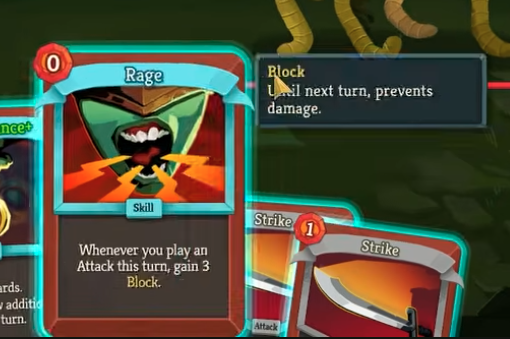

 [x] Sistema de descricao no preview - no preview de um componente, precisa de um tooltip ao lado (opcional) com alguma descricao, vai variar de componente pra componente, pode ter componente com descricao geral para o mesmo componente, vai ter componente com descricao para cada tipo, como por exemplos cartas. talvez fornecer um campo html para colocar essa descricao, esse pode aparece ao lado em baixo do preview
  [x] Sistema de tooltip de regras e/ou palavra chaves para o preview. Semelhante ao de cima mas um pouco mais sucinto e podento ter varios, ele pode seguir em caixas de tooltip acima da de descricao. A ideia aqui é ser uma caixa melhor com a explicacao de uma palavra chave que aparece no componente similar ao slay the spire 2 como visto na imagem
  
  Podemos parametriza na hud para aparecer ele sempre no preview ou apenas quando parar o nome em cima de uma palavra chave, essa configuracao podemos fazer nos html de descricao. Na configuracao do jogo temos a lista de palavras chaves com a sua propria html de tooltip, e se o usuario colocar um "hyperlink" ou algo do tipo em uma palarvra ou pedaco de texto com o id da palavra chave teremos vinculado o tooltip com os 2 modos de visualizacao.
  [x] Tooltip de descricao e de palavras chaves tambem aparecem se parar em cima de um componente ao lado dele
  [x] Mao do jogador, quando esta na visao do jogador, teremos esse novo componente que carregara as cartas e outros componentes que o jogador carrega na mao, slay the spire é um exemplo, mas o tabletop simulator tem tambem. Hoje esse componente fica no tableau mesmo mas fica ruim de navegar na mesa e ter que voltar para mao toda hora, isso manteria ela como placeholder em baixo da tela no fullscreen ou encostando na parte de baixo do iframe no modo normal. Com a funcao de destacar quando para o mouse em cima, assim como no slay the spire para facilitar visualizacao e selecao
  [x] Botao direito no componente apresenta as funcoes possiveis nele. Como por exemplo, preview, selecionar, mover. O mover por exemplo pode um segundo nivel que mostra os alvos habilitados para ser movidos.